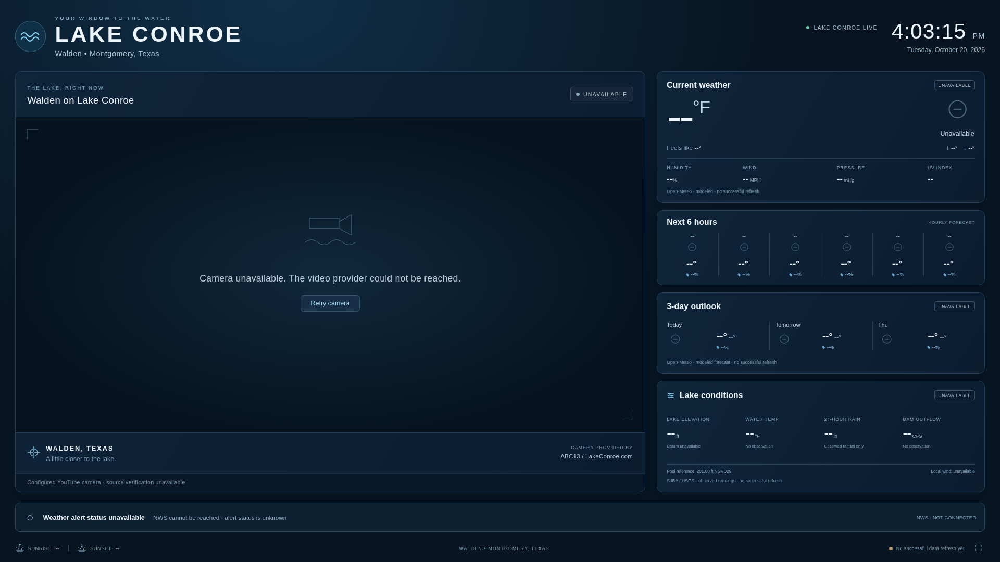

# Lake Conroe Live

A self-hosted weather and lake camera dashboard for Walden on Lake Conroe,
designed for a Raspberry Pi 4 running **Raspberry Pi OS 32-bit or 64-bit Desktop
(Bookworm/Trixie)** and a 1920 × 1080 landscape display. Also checked
at 1280 × 720. Vanilla HTML/CSS/JavaScript, one lightweight Python process, no
database, no mandatory cloud service, and no default API keys.



**This is an actual application screenshot, showing unavailable sources in the
development environment.** Its cloud proxy blocked the weather, lake, and camera
hosts. No example measurements or stock camera image are substituted. Fixture
tests pass, but live SJRA parsing, the current camera ID/playback, and OneRain
access remain unverified. See [verification](docs/verification.md).

## Run locally

Requires Python **3.11+**. From this checkout:

```sh
python3 -m venv .venv
.venv/bin/python -m pip install --only-binary=:all: -r requirements.txt
cp -n config/settings.example.json config/settings.local.json
.venv/bin/python -m app
```

Open the dashboard on loopback port **8080** in your browser. The server binds
only to `127.0.0.1` by default. The Pi launcher opens Chromium in kiosk mode;
the fullscreen button is useful for ordinary desktop testing. Add `?kiosk=1`
to hide the cursor. The clock and data refreshes never reload the page.

For Raspberry Pi OS installation, boot startup, screen blanking, and switching
between this dashboard and an existing sports scoreboard, follow the
[Pi guide](docs/raspberry-pi.md). The installer changes no other kiosk or desktop
autostart configuration. Its service names are `lake-conroe-live.service` and
`lake-conroe-kiosk.service`.

All runtime dependencies are pinned, and binary-wheel resolution was verified
for ARMv7 CPython 3.11/3.13. The Pi installer requires Python 3.11+ and avoids
native source builds. See the Pi guide for 32-bit installation details and
selecting a free port alongside the sports scoreboard.

## Configuration

Edit the ignored `config/settings.local.json` and restart the Python server.
`LAKE_CONROE_CONFIG` selects another JSON file. Partial JSON files are merged
with defaults; an explicitly selected missing file is an error. Secrets do not
belong in the JSON file or this repository.

| Setting | Default / purpose |
| --- | --- |
| `title` | `LAKE CONROE` |
| `location` | Approximate Walden coordinates, 30.402 / -95.608; display label |
| `timezone` | `America/Chicago`; clock and local calendar dates respect DST |
| `temperature_unit` | `fahrenheit` or `celsius`; lake/other units stay ft, in, MPH, CFS |
| `weather.provider` | `open-meteo`; weather is explicitly labeled **modeled** |
| `camera` | Supported YouTube player, source-page discovery, optional alternative URL; see [camera guide](docs/camera.md) |
| `polling` | Weather 300s, daily forecast 1800s, lake 180s, NWS alerts 120s, camera discovery 1800s |
| `panels` | Independently show/hide weather, hourly, forecast, lake panels |
| `server` | Bind address, port 8080, cache directory |
| `lake` | USGS station 08067600 and separately labeled 201 ft NGVD29 pool reference |

Polling intervals must be at least 60 seconds. `LAKE_CONROE_CACHE_DIR` can
override the default `.cache/lake-conroe-live` directory. Cache files are small,
atomic JSON records. One application worker owns the polling/cache; run a single
process rather than multiple Uvicorn workers. Browser clients poll the local
cache every 15 seconds without multiplying upstream requests.

## Sources and reliability

- **Weather / forecasts:** Open-Meteo; current conditions, apparent temperature,
  humidity, wind, surface pressure, UV, six forecast hours, three forecast days,
  sunrise and sunset. Model valid times are distinct from fetch timestamps.
- **Lake:** SJRA published readings through backend adapters, with a USGS
  structured fallback where compatible measurements exist. Individual readings
  retain their published times, source, and elevation datum. Unknown is shown
  rather than guessed. No datum conversion or unverified rainfall total is used.
- **Alerts:** Official NWS alerts for the configured coordinates, severity
  colors, and cycling headlines. Unreachable/stale alert service is **unknown**,
  never “no alerts.”
- **Camera:** Official embedded player with muted autoplay and bounded retry.
  The red LIVE badge requires actual PLAYING state. A configurable refreshed
  image is labeled as an image. Provider embedding restrictions are respected.

Refresh tasks run independently with timeouts and bounded backoff. Failed
refreshes preserve last-good values and timestamps, mark them stale, and retry.
Lake observations older than 30 minutes are marked stale separately from the
source fetch time. Unavailable fields display `--`; production contains no
demonstration values. Forecast tiles match actual local calendar dates even
when cached across midnight.

The [source documentation](docs/data-sources.md) records URLs, conversions,
datums, timestamp semantics, provider terms, and the limitations around current
SJRA HTML and OneRain. **24-hour measured rainfall is currently unavailable:**
no compatible public interval feed has been confirmed. This is deliberate.

## Health and troubleshooting

```sh
curl --fail http://127.0.0.1:8080/api/health
curl --fail http://127.0.0.1:8080/api/lake
```

`/api/health` returns HTTP 200 when the local service is available, with overall
`ok`/`degraded` and each source's status, last attempt/success, refresh age, and
error. Here `live` means a freshly fetched source cache; camera playback can
only be verified by the browser. `/api/dashboard` supplies the complete public
configuration and cached results; `/api/weather`, `/api/forecast`, `/api/lake`,
`/api/alerts`, and `/api/camera` expose individual sources. Fetch/parse failures
are logged to stderr or the systemd journal.

If all data is unavailable, first inspect source errors and verify outbound
HTTPS access from the actual deployment machine. The required hosts are listed
in the source documentation. Do not disable TLS verification. If the camera
fails, check its official page, source ID, and embedding permission; a working
source-page request alone does not verify playback. Check the Pi's system time
if timestamps or TLS look wrong. The interface recovers without a browser reload
when connectivity returns.

## Tests and screenshots

No extra Python test dependency is needed:

```sh
.venv/bin/python -m unittest discover -s tests -v
bash -n scripts/install-pi.sh scripts/start-kiosk.sh
./scripts/install-pi.sh --dry-run --install-packages --enable-server --install-kiosk-unit
```

Optional development-only browser checks require Node.js 20+ and Chromium:

```sh
npm ci
# Run the Python server in another terminal first.
CHROMIUM_PATH=/usr/bin/chromium npm test
```

If Chromium is installed elsewhere, change `CHROMIUM_PATH`. Node and Playwright
are **not** production dependencies and need not be installed on the Pi.
`scripts/test-display.mjs` checks both resolutions with actual responses and
isolated, clearly identified test fixtures. It saves actual current-instance
screenshots to `docs/dashboard-1920x1080.png` and
`docs/dashboard-1280x720.png`; it never saves fixture data as a live screenshot.
`scripts/test-camera.mjs` exercises the supported-player lifecycle using an
explicitly mocked player. This does not verify real YouTube availability.

The repository contains the frontend in `static/`, backend in `app/`, data
adapters in `app/providers/`, configuration example in `config/`, systemd
templates in `deploy/`, Pi scripts in `scripts/`, and tests in `tests/`.
